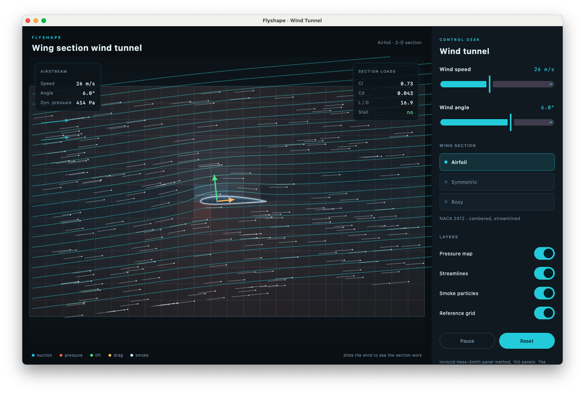

# Flyshape — wing section wind tunnel

A Compose Multiplatform desktop app that puts a 2-D wing section in a virtual
wind tunnel. You see the section from the side, the airstream bending around it,
and the loads it carries.

## What you see

- **Streamlines** traced through the real velocity field, tinted by local speed —
  watch them crowd and brighten over the suction side.
- **Smoke particles** advected by the flow, streaking back along their own velocity.
- **Pressure map**: warm where the air is compressed, cold where it is sucked.
- **Lift and drag vectors** resolved at the quarter chord.
- **Instruments**: wind speed, angle, dynamic pressure, `Cl`, `Cd`, `L/D` and a
  stall flag.

## Controls

| Control | What it does |
| --- | --- |
| **Wind speed** (0–60 m/s) | Speed of the airstream and of the smoke. |
| **Wind angle** (−25°…+25°) | Rotates the airstream. This is the angle of attack, so it is what makes the section lift or dive. |
| **Wing section** | `Airfoil` (NACA 2412, cambered), `Symmetric` (NACA 0012) or `Boxy` (rounded rectangle, bluff). |
| **Layers** | Toggle the pressure map, streamlines, smoke and reference grid. |
| **Pause / Reset** | Freeze the smoke to study a frame, or restore the defaults. |

## How it works

The flow is solved with a **Hess–Smith panel method**: every panel carries a
constant-strength source distribution and the whole contour carries one
constant-strength vortex distribution, closed with a Kutta condition at the
trailing edge. That makes the solver valid for *any* closed contour, which is why
one code path can show both a streamlined airfoil and a blunt boxy section.

Because the problem is linear, the solution is computed once for a unit
freestream and then scaled by the speed slider — only a change of shape or angle
triggers a new solve (about a millisecond for 100 panels). Particle advection and
drawing are allocation-free per frame.

The painted flow is inviscid potential flow, so it never separates. The `Cl`,
`Cd` and `L/D` readouts are corrected with a finite-wing lift slope, induced
drag and an empirical stall past 14.5°; the section is honest about this in the
app itself.

## Where the code lives

- `shared/src/commonMain/kotlin/.../sim` — geometry, panel solver, streamlines,
  particles, aerodynamic metrics. Pure Kotlin, no Compose, covered by tests.
- `shared/src/commonMain/kotlin/.../ui` — the screen, canvas painting and controls.
- `shared/src/commonTest/kotlin/.../sim` — validation against known results
  (a circular cylinder, thin-airfoil theory, lifted cambered sections).

### Running it

- Hot reload: `./gradlew :desktopApp:hotRun --auto`
- Standard run: `./gradlew :desktopApp:run`
- Tests: `./gradlew :shared:jvmTest`

---

This is a Kotlin Multiplatform project targeting Desktop (JVM).

* [/shared](./shared/src) is for code that will be shared across your Compose Multiplatform applications.

  It contains several subfolders:
    - [commonMain](./shared/src/commonMain/kotlin) is for code that’s common for all targets.
    - Other folders are for Kotlin code that will be compiled for only the platform indicated in the folder name.
      For example, if you want to use Apple’s CoreCrypto for the iOS part of your Kotlin app,
      the [iosMain](./shared/src/iosMain/kotlin) folder would be the right place for such calls.
      Similarly, if you want to edit the Desktop (JVM) specific part, the [jvmMain](./shared/src/jvmMain/kotlin)
      folder is the appropriate location.

### Running the apps

Use the run configurations provided by the run widget in your IDE's toolbar. You can also use these commands and
options:

- Desktop app:
    - Hot reload: `./gradlew :desktopApp:hotRun --auto`
    - Standard run: `./gradlew :desktopApp:run`

---

Learn more about [Kotlin Multiplatform](https://www.jetbrains.com/help/kotlin-multiplatform-dev/get-started.html)…